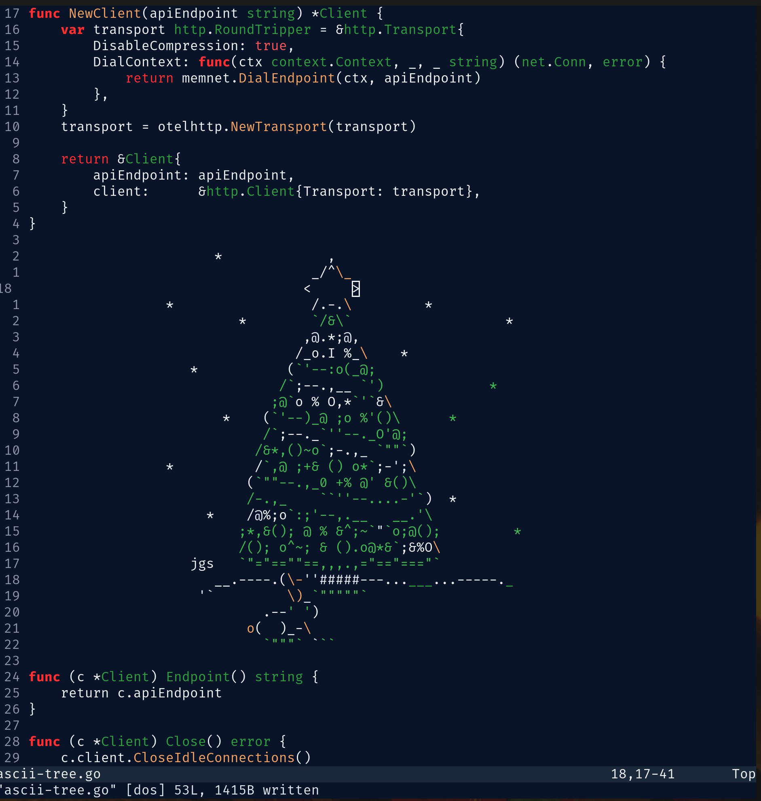

# 🎄 Christmas.nvim

A festive Neovim colorscheme to accompany you during Advent of Code.

## Installation

**Lazy:**

```lua
return {
  { "chaserensberger/christmas.nvim" }
}
```

## Usage

```lua
vim.cmd("colorscheme christmas")
```

## Preview


